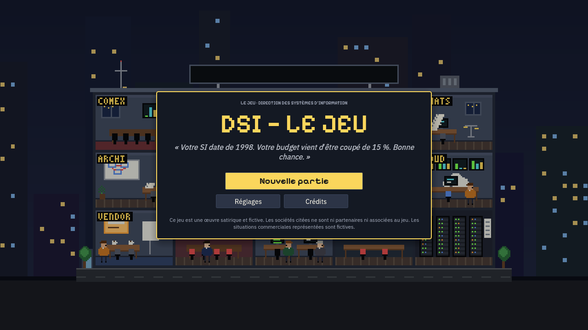
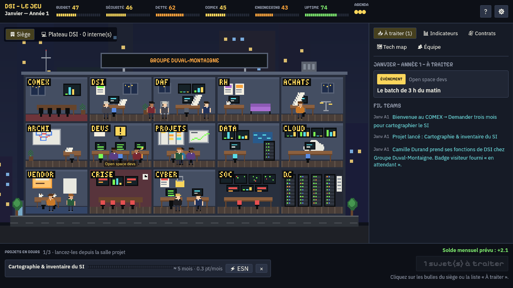
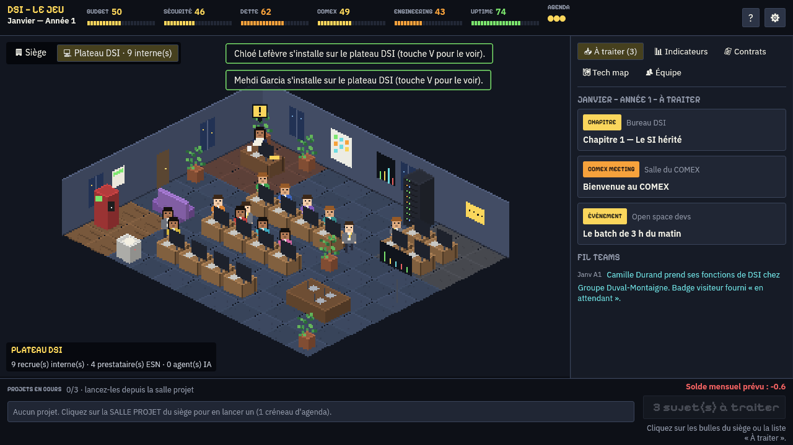
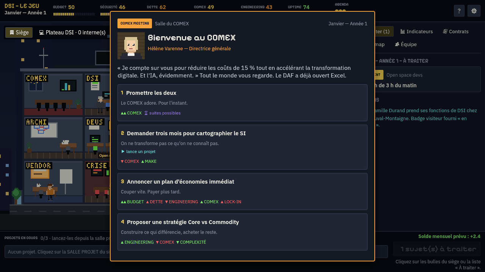
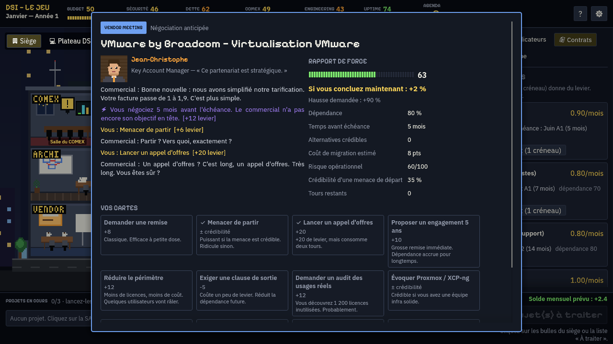
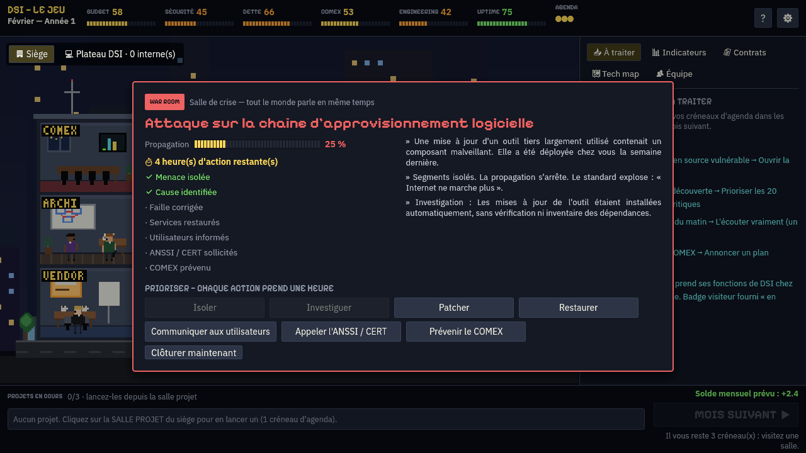

# DSI — LE JEU

> « Votre SI date de 1998. Votre budget vient d'être coupé de 15 %. Bonne chance. »

Un jeu de gestion satirique où vous incarnez le ou la **DSI d'un grand groupe français**.
Trois ans pour transformer un SI historique, propriétaire et piloté par 18 ESN en
organisation capable de construire ses propres produits — sans faire exploser le budget,
la dette technique, la sécurité, ni la patience du COMEX.

**BUY → BUY + BUILD → MAKE** · **Waterfall → Agile → DevOps → … → Agentic Enterprise**

Écrit en Rust avec Bevy et egui, compilé en WebAssembly, joué dans le navigateur.
Dans la lignée technique d'[A la French — le jeu](https://mehdim.github.io/french-tech-le-jeu/),
avec un code, des textes, un pixel art et des sons entièrement originaux.



| Le siège (15 salles cliquables) | Le plateau DSI isométrique |
|---|---|
|  |  |

| Événement | Négociation fournisseur | War room |
|---|---|---|
|  |  |  |

> Ce jeu est une œuvre satirique et fictive. Les sociétés citées ne sont ni partenaires ni
> associées au jeu. Les situations commerciales représentées sont fictives. Les noms
> d'entreprises apparaissent en texte, sans logo.

---

## Le jeu

- **1 tour = 1 mois**, trois années de campagne (Janvier année 1 → COMEX final année 3).
- **Saison 2** : une fois la fin atteinte, le bouton « Continuer 3 années de plus » prolonge
  la même partie jusqu'à l'année 6 (SI, équipe, contrats et indicateurs conservés), avec de
  nouveaux chapitres, objectifs annuels et sujets scénarisés : NIS2, règlement européen sur
  l'IA, panne d'une région cloud, assureur cyber, fusion et scission du SI, cryptographie
  post-quantique, empreinte du numérique, un agent IA par salarié, succession du DSI. Une
  nouvelle fin est calculée à la fin de l'année 6.
- **Objectifs de fin explicites** : chaque fin affiche ses conditions chiffrées, la valeur
  actuelle de chaque indicateur et les leviers pour l'atteindre (onglet Indicateurs). Au
  lancement de la saison 2, on choisit son **cap** (la fin visée) : suivi en barre du bas
  et à chaque COMEX annuel ; s'il est atteint en fin d'année 6, c'est lui qui est retenu,
  avec +5 points de score. En changer coûte 1 créneau et 2 points de COMEX.
- Chaque mois apporte des **sujets** (bulles au-dessus des salles du siège) : événements
  scriptés, événements aléatoires pondérés par l'état du SI, conséquences de vos
  décisions passées, renouvellements de contrats, chapitres.
- **Le temps est la ressource rare** : 3 créneaux d'agenda par mois pour agir dans les
  salles (lancer un projet, recruter, négocier en avance, auditer, écouter le dev senior…).
- **Chaque décision fait mal quelque part.** Les choix montrent le *sens* des effets (▲▼),
  jamais leur ampleur ; ⏳ signale des suites différées.
- **Licenciements** (onglet Équipe) : arrêter le salaire d'une recrue pour tenir le budget.
  Sans indemnités pendant la période d'essai (3 mois), 3 mois de salaire ensuite ; MAKE,
  équipes et attractivité baissent, d'autant plus si les départs se répètent dans l'année.
- **Sauvegardes** : sauvegarde automatique + 3 emplacements manuels (nom, date de jeu, score,
  état de la partie, ancienneté), chargement depuis l'écran titre ou en cours de partie.
- **Budget mensuel détaillé** (bas droite et onglet Indicateurs) : allocation du DAF et sa
  répartition entre salaires (équipe historique + recrues), logiciels et contrats,
  ESN (régie + renforts projets), cloud / IA et projets, avec le solde du mois.
- **18 indicateurs**, tous visibles en barre du haut (la première ligne regroupe ceux qui
  peuvent mettre fin à la partie ; leur nom clignote en rouge à l'approche du seuil),
  antagonistes entre eux ; les métriques « de flux » tendent vers une cible
  calculée à partir du reste du SI.
- **Votre DSI** : directrice ou directeur, 16 avatars aux origines, teints et coiffures
  variés (afro, tresses, locks, hijab…), avec le sprite assorti sur le plateau.
- **Trois mentors d'A la French** : Mehdi (APIs et écosystèmes), Steeve (infra, cloud et
  inférence IA) et Jean-Baptiste (open source, souveraineté et recrutement). Le mentor
  principal, choisi à la création, apporte un bonus permanent et revient tous les 2 mois ;
  les autres, tous les 4. Chaque conseil (touche `M` ou portrait en bas à gauche) dépend de
  la situation : un renouvellement qui approche, une facture cloud qui dérive, un Kubernetes
  ingérable… et rapporte un petit bonus (par exemple +10 de levier à la négociation suivante).
- **Tutoriel guidé par le mentor** pendant les premiers mois : des bulles désignent
  l'élément à utiliser (jauges, agenda, sujets, salle projet, bouton du mois, contrats,
  plateau, mentors) et avancent quand l'action est faite. Ensuite, une bulle « prochaine
  action » accompagne le premier semestre. Désactivable dans les réglages.
- **Le gros bouton d'action** en bas à droite du monde : orange « SUJET SUIVANT » tant que
  des sujets attendent, puis jaune « MOIS SUIVANT ▶ » (ou barre d'espace).
- **Musique d'A la French** : le thème du podcast en 16 bits au menu, puis une playlist au
  bureau (thème, « La Marseillaise » 8-bit, gigue celtique), reprise d'« A la French — le
  jeu ». Volume réglable.
- **Deux vues du monde** (touche `V`) :
  - **Le siège** en coupe : COMEX, bureau DSI, DAF, RH, achats, architecture, open space,
    salle projet, data, cloud control room, vendor meeting room, salle de crise, cyber,
    SOC, datacenter. Les salles qui ont un sujet s'allument ; l'incident clignote en rouge.
  - **Le plateau DSI** en 3D isométrique : votre DSI à son bureau, le mobilier, chaque
    recrue qui arrive par la porte, s'installe et tape au clavier, les pauses café, les
    prestataires ESN dans leur coin (leur nombre suit le contrat de régie), les agents IA
    et la plateforme de contexte une fois débloqués. Survolez quelqu'un pour voir son nom.
- **Mini-jeux** :
  - *Négociation fournisseur* : rapport de force 0–100, cartes (appel d'offres, menace de
    départ pondérée par sa crédibilité, migration crédible, clause de sortie, engagement
    5 ans…), aléas (« fin de trimestre commercial », « la DG adore le fournisseur »),
    temps restant avant échéance. Négocier tôt donne du levier, attendre J-2 coûte −40.
  - *Recrutement* : entretien en 3 questions (« Quelle version de Java utilisez-vous ? »),
    intérêt du candidat, offre salariale ; mentir se paie plus tard.
  - *War room* : isoler, investiguer, patcher, restaurer, communiquer, appeler l'ANSSI,
    prévenir le COMEX — dans le bon ordre, avant que la propagation n'atteigne 100 %.
    Aucune technique offensive : le jeu porte sur la prévention et la réponse.
- **Projets multi-mois** (≈ 40, jusqu'à 5 en parallèle) avec coût, durée, complexité, risque de glissement,
  renfort ESN possible, effets à la livraison et technologies débloquées.
- **Choix de la solution** pour certains projets (coût, durée, risque, contrat souscrit et
  effets propres à chaque option) :
  - suite collaborative open source : La Suite numérique ou ElixirOffice ;
  - flotte mobile sans Google ni Apple : Fairphone sous /e/OS avec Murena (support interne)
    ou en location chez Commown (support et réparation inclus) ;
  - sortie d'Atlassian : OpenProject Community ou Enterprise ;
  - sortie des hyperscalers (AWS, Azure, Google Cloud) : Scaleway, OVHcloud ou Clever Cloud
    (aussi proposés, avec Cloud Temple, pour la migration vers un cloud de confiance).
- **Technology Map** (infra, dev, culture, data, IA, identité, applications) : chaque
  techno a des effets mensuels parfois conditionnels — Kubernetes accélère si vous avez
  les compétences, sinon il fait exploser la complexité.
- **Culture engineering** : Waterfall → Agile → CI/CD → DevOps → DevSecOps → SRE →
  Platform Engineering → MLOps → AI Engineering → Agentic Engineering, par des projets
  de transformation (on ne « passe pas DevOps » en cliquant).
- **Vibe coding** et métrique **CODE GÉNÉRÉ / CODE COMPRIS** ; **MCP** (« 340 serveurs,
  qui peut appeler quoi ? ») ; **Enterprise Context Platform**.
- **7 défaites** (Vous êtes viré, Cyber Apocalypse, Bankruptcy as a Service, Legacy
  Forever, Vendor Lock-In, Nobody Knows Anything, Kubernetes Singularity) et **6 fins**
  (DSI souveraine, Software Company, Cloud Native Enterprise, Engineering Culture,
  Agentic Enterprise, Pragmatic CIO — la plus difficile).
- **Score** sur 10 indicateurs et classement (de « Directeur du PowerPoint » à « Vous
  avez probablement triché. »), revue du COMEX chaque décembre avec objectifs annuels.

### Contenu actuel

| | |
|---|---|
| Événements | 100+ (campagne année 1 complète selon le cahier des charges, ossature années 2–3, saison 2 années 4–6, chaînes narratives, pool aléatoire) |
| Fournisseurs | 30 (éditeurs, hyperscalers, acteurs européens, ESN, télécoms) |
| Contrats | 18 (9 actifs au départ) |
| Technologies | 50+ réparties en 7 branches |
| Projets / actions | 40 projets, 26 actions de salle |
| Crises (war room) | 6 scénarios |
| Personnages | 13 récurrents + le ou la DSI |

### Commandes

| Action | Souris | Clavier |
|---|---|---|
| Traiter un sujet | clic sur la salle qui a une bulle, ou sur la liste « À traiter » | |
| Choisir une option | clic | `1`–`5` |
| Continuer | « Continuer » | `Entrée` |
| Sujet suivant / mois suivant | gros bouton en bas à droite | `Espace` |
| Mentors | portrait en bas à gauche | `M` |
| Siège / plateau DSI | boutons en haut à gauche | `V` |
| Onglets (à traiter, indicateurs, contrats, tech map, équipe) | onglets | `A` `I` `C` `T` `E` |
| Réglages (texte, sons, animations, contraste, reset) | ⚙ | `Échap` |

Accessibilité : taille du texte réglable, contraste renforcé, animations réductibles,
sons coupables, navigation clavier (Tab) dans les menus.

### Paramètres d'URL

- `?seed=1234` : rejoue exactement les mêmes aléas.
- `?debug=true` : fenêtre de debug (modifier les stats, déclencher un événement, recruter
  instantanément, accélérer le temps, débloquer une techno, inspecter l'état JSON).
- `?renderer=webgl2` / `?renderer=webgpu` : forcer le rendu.

---

## Installation et lancement

Les joueurs n'ont besoin que d'un navigateur avec WebAssembly et WebGPU ou WebGL2
(Chrome/Edge 113+, Firefox 115+, Safari 17+). Sans ces API, la page affiche un écran
explicatif au lieu d'un canvas noir.

### Prérequis de développement

```bash
rustup target add wasm32-unknown-unknown
cargo install wasm-bindgen-cli --version 0.2.129 --locked   # la version de Cargo.lock
# optionnel, pour un .wasm plus petit : wasm-opt (binaryen natif) dans le PATH
```

### Tests de la simulation (sans GPU)

```bash
cargo test            # dsi-core + platform : règles, événements, contrats, négociation,
                      # recrutement, war room, sauvegarde, score, parties complètes
cargo run -p dsi-core --example balance --release   # équilibrage sur 900 parties simulées
```

### Build navigateur et lancement local

```bash
tools/build-web.sh                         # WebGPU + repli WebGL2, profil optimisé → dist/
RENDERERS=webgl2 PROFILE=dev tools/build-web.sh   # itération rapide
cd dist && python3 -m http.server 8080     # puis http://localhost:8080
```

Le jeu ne fonctionne pas en `file://` (le wasm et les sprites sont chargés en HTTP).

### Déploiement GitHub Pages

Le workflow `.github/workflows/pages.yml` compile et publie à chaque push sur `main`.
Réglage unique : *Settings → Pages → Source : GitHub Actions*. Le site est alors servi sur
`https://<propriétaire>.github.io/<dépôt>/`. `ci.yml` lance les tests, clippy, le build web
et un test de fumée dans Chromium.

---

## Architecture

```
crates/dsi-core       Simulation déterministe en Rust pur, testable sans rendu
  state.rs            GameState, métriques, calendrier, file de sujets, scène active
  game.rs             API de commandes (Open, Choose, AdvanceMonth, StartProject…)
  economy.rs          budget mensuel, entropie, métriques de flux, jugement du COMEX
  events.rs           événements scriptés / aléatoires pondérés / enchaînés / différés
  conditions.rs       conditions data-driven (métriques, technos, flags, projets…)
  effects.rs          effets, conséquences différées, paris, mini-jeux, rendements décroissants
  contracts.rs        contrats, échéances, dépendance
  vendors.rs          fournisseurs, cartes de négociation, aléas
  negotiation.rs      mini-jeu de négociation
  people.rs           recrutement (entretien) et équipe interne
  projects.rs         projets multi-mois, glissements, renfort ESN
  technology.rs       Technology Map et effets passifs conditionnels
  skills.rs           échelle de culture engineering, curseur BUY/MAKE
  security.rs         war room
  mentors.rs          mentors : bonus permanent, conseils contextuels, délais
  cloud.rs            facture cloud, FinOps, dérive
  ai.rs               vibe coding, code généré / code compris
  score.rs            score, classement, revue annuelle, fins
  save.rs             sauvegarde JSON versionnée
crates/platform       stockage (localStorage / fichiers), horloge, paramètres d'URL
crates/dsi-client     Bevy 0.19 + bevy_egui 0.42
  world.rs            le siège en coupe, caméra, sélection des salles
  plateau.rs          le plateau DSI isométrique (personnages, mobilier, comportements)
  ui/                 HUD, panneaux, popups, mini-jeux, salles, menus, mentors,
                      tutoriel, debug
  audio.rs            effets sonores WebAudio procéduraux + musique (<audio>, Ogg/MP3)
data/*.json           TOUT le contenu : events, vendors, technologies, projects,
                      careers, dialogues, crises, mentors
assets/               sprites et portraits générés par tools/art/*.py, polices OFL
web/                  index.html + loader.js (détection WASM / WebGPU / WebGL2)
```

Le client n'écrit jamais l'état directement : il envoie des `Command` à `dsi-core`, qui
renvoie une erreur lisible si l'action est impossible. La sauvegarde automatique a lieu
après chaque commande réussie (`localStorage`, clé `dsi-le-jeu:autosave`). Trois emplacements
de sauvegarde manuelle (`dsi-le-jeu:slot1` à `slot3`) s'ouvrent avec le bouton « Sauver »,
la touche S, le menu Échap ou « Charger une partie » sur l'écran titre. Pour ajouter un
backend plus tard, il suffit d'une autre implémentation du trait `platform::Storage`.

---

## Ajouter du contenu (sans toucher au moteur)

Les fichiers de `data/` sont embarqués à la compilation et **validés par les tests**
(`cargo test` signale toute référence inconnue : projet, techno, contrat, personnage…).

### Ajouter un événement — `data/events.json`

```json
{
  "id": "excel_db_2",
  "kind": "event",
  "room": "data",
  "speaker": "data",
  "weight": 1.0,
  "repeatable": true,
  "cooldown": 6,
  "weight_by": { "debt": 1.0 },
  "conditions": { "min": { "budget": 10 }, "technology": "excel_db" },
  "title": "Un nouvel Excel critique",
  "text": "1 à 4 phrases, drôles et crédibles.",
  "choices": [
    { "label": "Option A", "hint": "facultatif", "effects": { "budget": -2, "data_quality": 3 },
      "result": "Ce qui se passe.",
      "delayed": [ { "in": 4, "jitter": 2, "chance": 0.5, "event": "incident_p1" } ] },
    { "label": "Option B", "start_project": "data_governance" },
    { "label": "Option C", "gamble": { "p": 0.5, "p_by": { "make": 0.4 },
      "win": { "effects": { "velocity": 3 }, "result": "…" },
      "lose": { "effects": { "uptime": -5 }, "result": "…" } } },
    { "label": "Option D", "minigame": { "type": "negotiation", "contract": "oracle_db" } }
  ]
}
```

- `kind` : `event`, `vendor`, `comex`, `incident`, `project`, `recruitment`, `contract`, `architecture` (type de popup).
- `room` : `comex`, `dsi`, `finance`, `rh`, `achats`, `archi`, `devs`, `projet`, `data`, `cloud`, `vendor`, `crise`, `cyber`, `soc`, `datacenter`.
- Événement scripté : `"at": { "year": 1, "month": 3 }` ; aléatoire : `"weight" > 0`.
- Effets possibles d'un choix : `effects`, `delayed`, `start_project`, `add_tech`,
  `remove_tech`, `set_flag`, `clear_flag`, `chain`, `minigame` (`negotiation`, `recruit`,
  `war_room`), `allocation`, `agenda`, `contract_cost`, `end_contract`, `add_contract`,
  `lose_hire`, `cloud_provider`, `cloud_bill`, `finops`, `code_generated`, `code_understood`.
- Métriques : `budget`, `debt`, `uptime`, `security`, `velocity`, `user_sat`, `dev_sat`,
  `comex`, `vendor_dep`, `sovereignty`, `make`, `complexity`, `attractiveness`,
  `data_quality`, `cloud_maturity`, `devops_maturity`, `ai_maturity`, `resilience`.

### Ajouter un fournisseur ou un contrat — `data/vendors.json`

```json
{ "id": "monediteur", "name": "Mon Éditeur", "category": "ITSM", "sovereign": false,
  "lines": ["Ce partenariat est stratégique."] }
```

Puis un contrat qui le référence (`vendor`), avec `monthly_cost`, `term`, `first_renewal`,
`increase`, `dependency`, `tags`, `alternatives` (technos/projets qui rendent une migration
crédible) et `migration` (projets proposés au renouvellement). Les cartes de négociation et
les aléas se trouvent dans le même fichier.

### Ajouter une technologie — `data/technologies.json`

```json
{ "id": "service_mesh", "name": "Service mesh", "branch": "infra", "tier": 4,
  "desc": "Observabilité et sécurité réseau entre services.",
  "passive": [ { "when": { "min": { "devops_maturity": 60 } },
                 "then": { "security": 0.2 }, "else": { "complexity": 0.5 } } ] }
```

Pour la rendre atteignable, ajoutez un projet dans `data/projects.json` avec `"add_tech": ["service_mesh"]`.

### Graphismes et sons

Tout le pixel art est généré par `python3 tools/art/gen_art.py` (siège, ciel, salariés,
portraits, bulles) puis `python3 tools/art/gen_iso.py` (plateau isométrique). Les sons
sont synthétisés en direct par WebAudio (`crates/dsi-client/src/audio.rs`).

---

## Licences

Code : MIT ou Apache-2.0, au choix. La musique et les portraits des trois mentors viennent
d'« A la French — le jeu » (mêmes licences ; les animateurs ont donné leur accord pour
apparaître comme mentors). Polices : Pixelify Sans et IBM Plex Sans, SIL Open
Font License 1.1 (`assets/fonts/`). Les marques citées appartiennent à leurs propriétaires.
